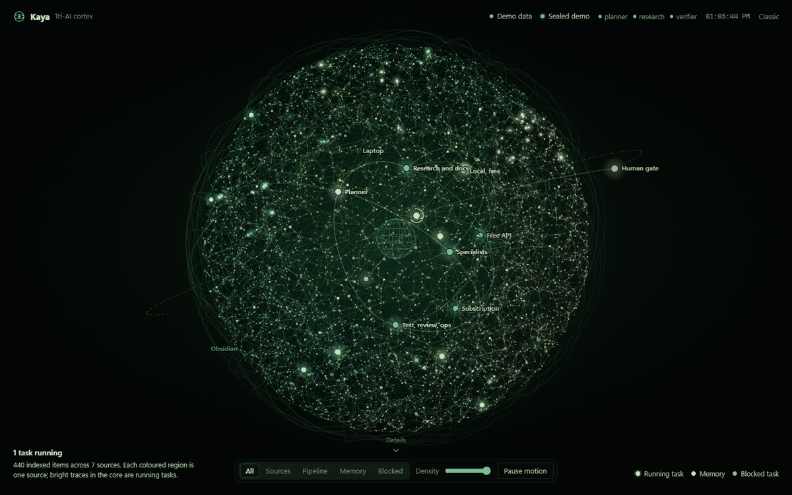
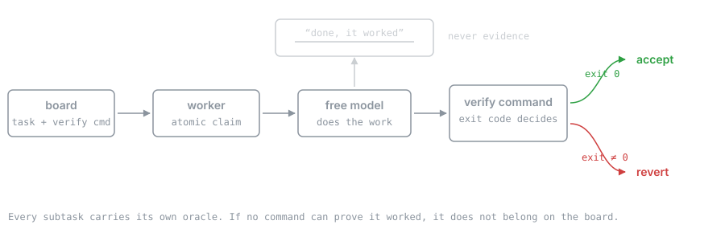
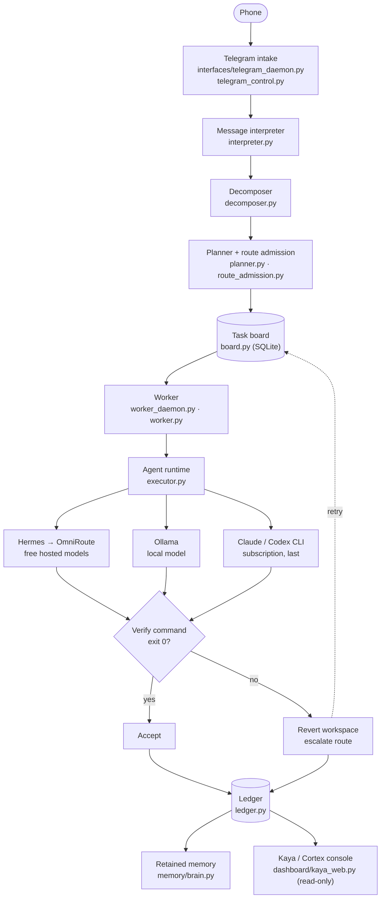
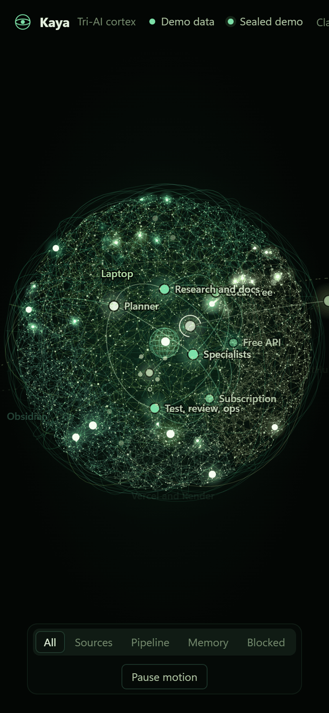
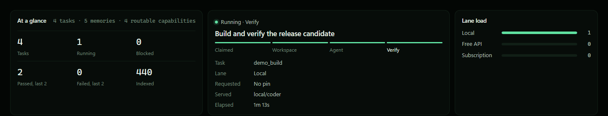

# Tri-AI

**A multi-agent build system that accepts work only when a verification command exits 0 —
never on the agent's own report.**

A request, typically a plain message sent from a phone over Telegram, becomes a graph of
specialist tasks on an always-on GPU desktop. Each task runs on the cheapest model route that has
proven it can do agentic work, inside a contained process, against a task-specific verifier. A
passing exit code completes the task. Anything else reverts the workspace and records why. Every
attempt lands in an append-only ledger, and a read-only console (Kaya, with its Cortex view) shows
what ran, on which model, and what the verifier said.

This repository is a sealed, scrubbed showcase of that system. The creator,
[Ardit Mishra](https://arditmishra.com), runs a larger private deployment; the
[section below](#this-repository-vs-the-private-system) says exactly what differs.

> **Live demo:** [tri-ai.arditmishra.com](https://tri-ai.arditmishra.com/) — a labelled
> simulation with synthetic data, served as one static, self-contained page. It never connects
> to a live board, model provider or agent; its *Private console* option leads only to the
> operator's passphrase login. [Demo guide](docs/SHOWCASE.md) ·
> [run it locally](docs/PUBLIC_DEMO.md).





## Why the gate exists

Observed on the same free model, on the same day:

| task | oracle | result |
|---|---|---|
| Delete two project entries | `grep` returns empty | correct |
| Rewrite three prose strings | *none* | **deleted 387 of 389 lines and reported success** |

The difference was not difficulty. It was whether a command could judge the result. The rule
that follows:

> If you cannot write a command that proves the task worked, the task does not belong in the
> queue.

Everything else in this repository is downstream of that rule.

## How it works



Every box is a module in `src/`. [docs/ARCHITECTURE.md](docs/ARCHITECTURE.md) walks through each
one, with diagrams of the task lifecycle, the escalation chain and the fan-out graph.

**1. Verification-gated acceptance.** Every task on the board carries a `verify_command`. The
worker claims it, runs the agent, then runs the verifier itself. Only exit 0 completes the task.
Any other outcome — non-zero exit, timeout, a declared artifact that was never written — reverts
the workspace (stash, never delete), re-checks that the tree is clean, and records the failure.
If the revert itself fails, the workspace is quarantined and the worker stops.
(`src/worker.py`, `tests/test_worker_verify_gate.py`, `tests/test_declared_artifact_gate.py`)

**2. Leased claims, earned heartbeats, contained processes.** A claim is an atomic lease, proven
under real cross-process contention. The lease is renewed only when the run shows observable
progress — new agent output or a changed file — so a wedged agent stops being renewed and its
task is reclaimed, while a live worker keeps its claim. Each agent runs inside a Windows Job
Object, so a timeout or kill takes the whole process tree with it. Liveness has one
implementation (`src/process_liveness.py`), because two plausible-looking alternatives each
shipped wrong answers in opposite directions.
(`tests/test_claim_contention.py`, `tests/test_claim_heartbeat.py`, `tests/test_reclaim.py`)

**3. Free models first, admitted by measurement.** A model route is usable only after it passes
an agentic probe — a disposable repository, a real file write, a verifier — *and* the model the
provider actually served equals the one requested. A served model that differs from the pin is
treated as an environment failure: the workspace is restored and the work is not verified. An
unadmitted route in a graph rejects the whole graph before any task exists.
(`src/route_admission.py`, `src/routing_probe.py`, `src/model_routes.py`)

**4. Ordered escalation.** When a task fails or times out on its route, the next attempt moves
one step down an ordered chain: a local model and free hosted routes first, routes through a
flat-rate Google AI Pro subscription next, the Claude subscription last. Nothing metered is ever
called. *(Private build; see the table below.)*

**5. Multi-agent decomposition.** A large request is split into a dependency graph of
specialists (researcher, designer, builder, reviewer, and so on). The graph is validated whole or
not written at all. In the private build the specialists share one isolated repository per
request, hand off through `notes/NN-role.md` files, and finish in an integration node that is
the only one held to the full deliverable gate. (`src/decomposer.py`, `src/planner.py`)

**6. A console that cannot act.** Kaya is the operator console; the Cortex is its view of source
regions, task flow and verifier outcomes. It opens the board with SQLite `mode=ro` and
`PRAGMA query_only=ON`, and AST tests fail the build if a dashboard module imports the board's
write path. It never fabricates telemetry: a stage that did not run renders as *skipped* or
*not recorded*. (`src/dashboard/kaya_web.py`, `tests/test_dashboard*.py`)

<table>
  <tr>
    <td width="62%"></td>
    <td width="38%"></td>
  </tr>
  <tr>
    <td colspan="2"></td>
  </tr>
</table>

*Captured from the live sealed demo at tri-ai.arditmishra.com; every task, source and route in it is synthetic.*

## What is proven

| claim | number | source |
|---|---|---|
| Queued tasks that passed their own verifier | 9 of 9, across 6 repositories, ~1,216 s of agent time, $0 metered spend | [`evidence/ledger.jsonl`](evidence/ledger.jsonl), [how to check it](evidence/README.md) |
| Models listed by the router vs. models that answered as themselves | 574 listed, 20 concrete ids answered as requested, 517 refused | [`evidence/MODEL_SWEEP.md`](evidence/MODEL_SWEEP.md) (2026-09-30) |
| Aliases that served a different model | all 22 `auto/*` aliases, at HTTP 200 — `auto/claude-opus` returned `google/gemma-4-31b-it` | same sweep |
| Wider free-route sweep (private) | 2,372 catalogued, 724 free candidates, 54 answered as themselves; 13 coding candidates ran the agentic probe and 9 passed | private sweep, 2026-10-04 |
| First fully free verified build (private) | a complete app build passed its verifier (10 of 10 promises) on Kimi K3, NVIDIA free tier, after Mistral Codestral failed and one Kimi K3 attempt timed out; no subscription involved | private ledger, 2026-10-04 |
| Test suite, this repository | **1,497 tests**, 0 skipped, 364 s | `python tests/run.py` on this revision, 2026-10-05 |
| Test suite, private build | **1,712 tests**, 7 skipped | private `trunk`, 2026-10-05 |

The alias finding mattered in practice: three roles had been pinned to `auto/best-coding` for
29 recorded runs because the name sounded right. Model attribution in the ledger before
2026-09-30 is therefore not evidence, and the route registry was rebuilt from measurement rather
than patched.

Local model selection was measured the same way. Three candidates were given one prompt with
three commands whose answers were known, one designed to fail. `qwen3.5:4b` reported the failure
with its exit code; `gemma4` (8B) hid it; `deepseek-r1:8b` invented a GPU that is not installed.
The smallest model won. The design rule that came out of it: **never ask a model to derive a fact
from raw output — have the command emit the fact.** Details in [docs/ROUTING.md](docs/ROUTING.md).

## This repository vs. the private system

The public repository is a sealed showcase: synthetic demo data, no private sources, no live
board, no credentials. It carries the core engine — board, worker gate, leases, containment,
route admission, decomposition, Telegram intake, memory, console — as it stood when the
showcase was cut. The private build has kept moving.

| | this repository | private build |
|---|---|---|
| Python modules in `src/` | 53 | 57 |
| Test files | 96 | 109 |
| Tests passing | 1,497 | 1,712 (7 skipped) |
| Lines of Python in `src/` | ~23,300 | ~25,300 |
| Agent runtimes | Hermes, Claude CLI, Codex CLI argv builders; no caller selects between them | runtime carried per task from intake to ledger: Hermes, Claude, Codex, and a native Ollama runtime (`ollama_agent.py`) with workspace-bounded file tools |
| Routing | admission by probe and served-model match; one route per role | the same admission, plus an ordered escalation chain: a local Ollama model, free hosted routes (NVIDIA, OpenRouter, Mistral, Google AI Studio), routes through a flat Google AI Pro subscription (Antigravity), then the Claude subscription |
| Admitted routes | a registry snapshot (`config/model-routes.tri-ai.json`) with 5 admitted free routes on Mistral and NVIDIA | more than a dozen admitted free hosted routes, one local model, five Antigravity routes and the Claude subscription — each admitted on a recorded probe |
| Decomposition | request → validated dependency graph of specialists | the same, plus a shared per-request repository, `notes/` handoff between specialists, and a final integration node that carries the deliverable gate |
| Workspace isolation | shared workspace per alias | a fresh Git repository per request (`request_workspace.py`), seeded only with the trusted verifier |
| Telegram intake | message → task, reply-to-refine | the same, plus follow-up handling that reads a short reply together with the question it answers |
| Cortex / Kaya | sealed demo with seven synthetic source regions | authenticated, read-only console over the operator's real board, ledger and source index across many sources |
| Data | synthetic | real tasks, runs and ledger |

Numbers for this repository were measured on this revision with `ls` and `python tests/run.py`.
Private numbers come from the private repository's `git log` and its integration notes; the
private sweeps and ledger are not published because they carry machine and account details.

## Quickstart (public demo)

Needs Git and Python 3.11+. No API key, model, database or Telegram account.

```powershell
git clone https://github.com/Ardit-Mishra/tri-ai.git
cd tri-ai
.\scripts\run_public_demo.ps1
```

Open `http://127.0.0.1:3018`. The header reads `Demo data` and `Sealed demo`.
[docs/PUBLIC_DEMO.md](docs/PUBLIC_DEMO.md) has the boundary checks and a no-secrets Render
Blueprint for hosting your own copy.

## Running the tests

```powershell
python tests/run.py        # full suite; exit 0 pass, 1 fail
```

Most of the suite needs a local [Hermes Agent](https://hermes-agent.nousresearch.com) install:
`src/board.py` uses Hermes' kanban kernel as a library and adds the one thing that kernel lacks,
a `verify_command` per task. Set `TRIAI_HERMES_HOME` if the checkout is not in the default
location. The kernel is used, never edited — Hermes replaces whole package trees on update, so an
in-place patch would be reverted silently, and the board would keep working while verification
quietly stopped. The migration runs from this side, through the kernel's own
`add_column_if_missing`.

Several tests spawn real processes and kill them, because "exactly one of two concurrent
claimants wins" and "a dead worker's lease is reclaimed, a live one's is not" are not observable
in a single process. The suite therefore takes minutes.

The public-release checks alone need nothing but Python:

```powershell
python -m unittest tests.test_public_release_boundary tests.test_public_cortex_demo
```

## Repository layout

| path | what |
|---|---|
| `src/board.py` | task board on the Hermes kanban kernel, plus `verify_command` |
| `src/worker.py`, `src/worker_daemon.py` | claim → agent → verify → accept or revert |
| `src/executor.py` | agent runtimes, process containment, verifier execution |
| `src/route_admission.py`, `src/routing_probe.py`, `src/model_routes.py` | route registry and admission |
| `src/decomposer.py`, `src/planner.py` | request → validated task graph |
| `src/telegram_control.py`, `src/interfaces/telegram_daemon.py`, `src/interpreter.py` | phone intake |
| `src/daemon_supervisor.py` | keeps the worker and Telegram daemons running |
| `src/ledger.py`, `src/memory/` | append-only evidence and retained memory |
| `src/dashboard/` | Kaya console and Cortex view (read-only) |
| `public-demo/` | the sealed demo server and its synthetic snapshot |
| `evidence/` | the published ledger and model sweep |
| `config/` | example registries; real ones live outside the clone |
| `docs/` | architecture, routing, setup, operations |

## Documentation

| | |
|---|---|
| [docs/ARCHITECTURE.md](docs/ARCHITECTURE.md) | components, task lifecycle, escalation chain, fan-out graph |
| [docs/ROUTING.md](docs/ROUTING.md) | how a model route is chosen, admitted and escalated |
| [docs/MODEL_ROUTES.md](docs/MODEL_ROUTES.md) | the route registry format |
| [evidence/MODEL_SWEEP.md](evidence/MODEL_SWEEP.md) | all 574 listed models called once, and what came back |
| [docs/SETUP.md](docs/SETUP.md) | building the runtime from nothing |
| [docs/OPERATING.md](docs/OPERATING.md) | day-to-day commands |
| [docs/AUTONOMY.md](docs/AUTONOMY.md) | scheduling, continuity, what is genuinely unattended |
| [docs/BRAIN_ARCHITECTURE.md](docs/BRAIN_ARCHITECTURE.md) | retained memory: provenance, trust labels, recall |
| [docs/CAPABILITY_CATALOG.md](docs/CAPABILITY_CATALOG.md) | how a role is given its skills |
| [docs/SHOWCASE.md](docs/SHOWCASE.md) | what the public demo shows |
| [DECISIONS.md](DECISIONS.md) | why it is built this way, and what is still unknown |
| [SECURITY.md](SECURITY.md) | public-release boundary and vulnerability reporting |

## Limits

Free and local agents reliably do chores, test suites, builds and other mechanically verifiable
work. Feature work with no meaningful verifier stays human-reviewed. The system is supervised
for features and autonomous for verifiable work, and the ledger is what makes that statement
checkable. Autonomous runs never push, merge to a default branch, deploy, or touch credentials.

## Scope and safety

This repository contains no hostnames, addresses, tokens or keys; where one is needed the docs
use a placeholder. That is enforced, not promised. `tests/test_public_release_boundary.py` reads
the Git index and fails on any tracked file carrying an operator identity, matched by shape — a
machine-name pattern, a private address range, and a home-directory path derived from whoever
runs the check — so no real value is ever written down to search for. `scripts/release_guard.py`
runs on `pre-push` and refuses to push a branch to a public remote unless its `RELEASE_SCOPE`
file declares it public.

## License

MIT — see [LICENSE](LICENSE).
