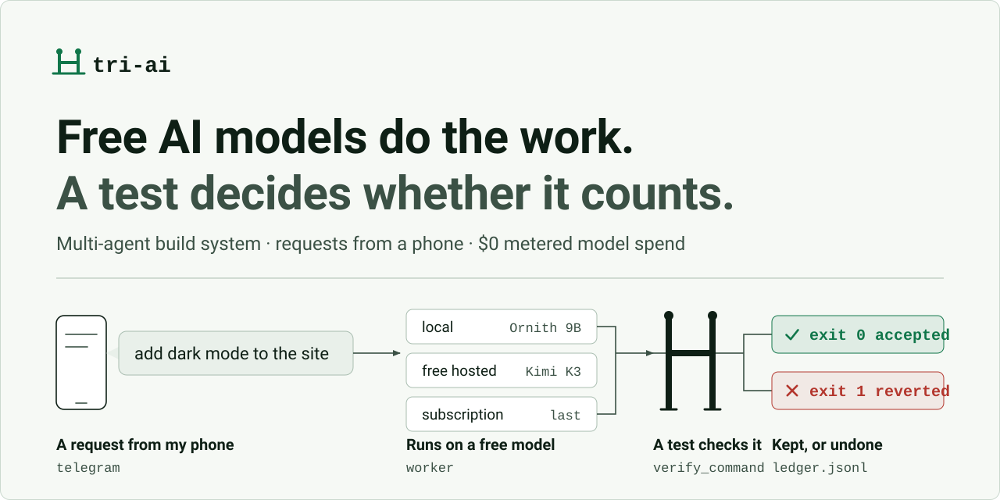
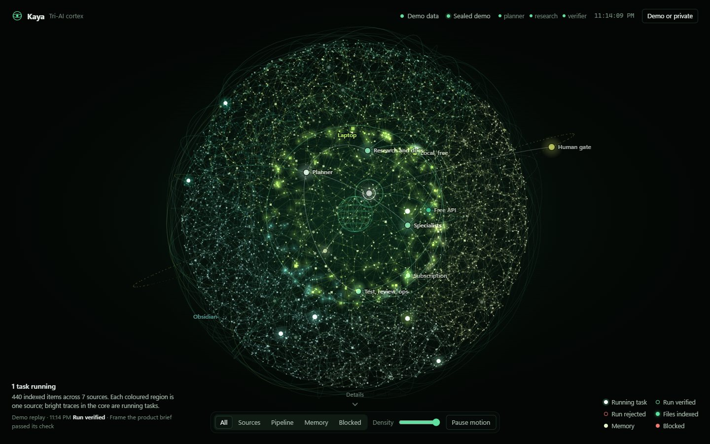
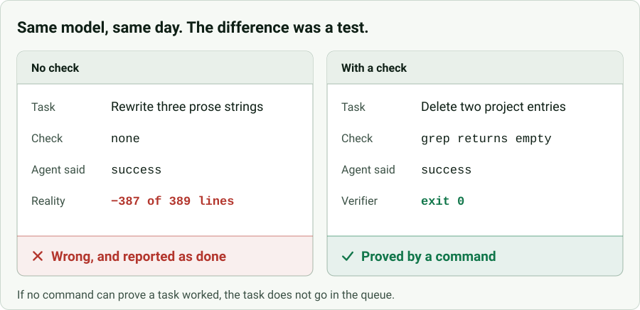
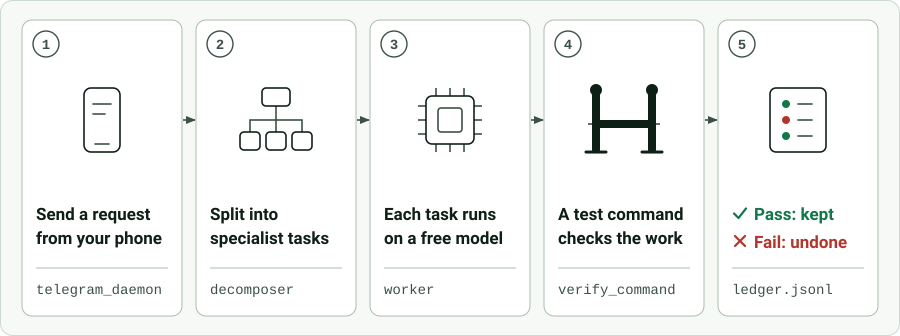
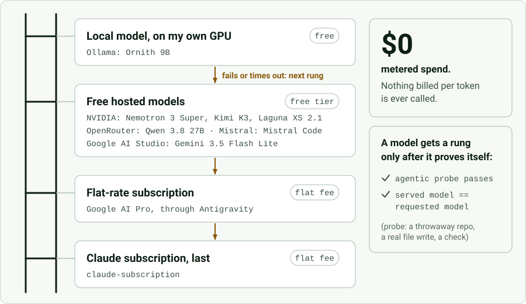
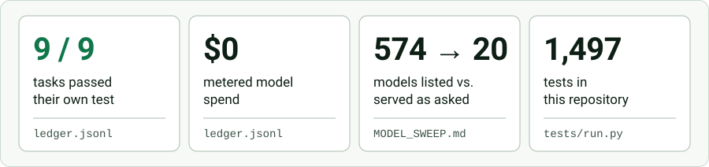
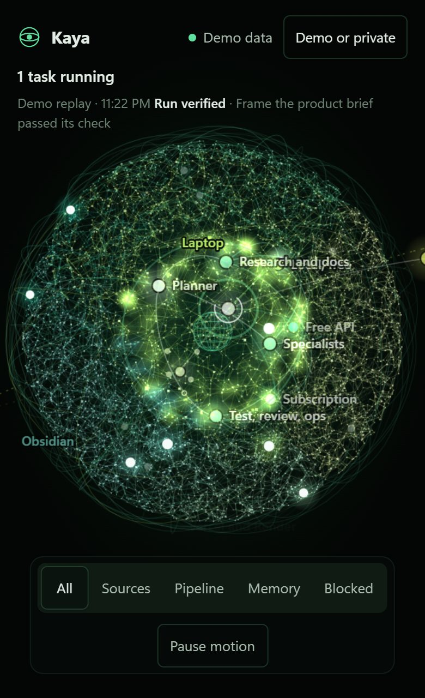

<p>
<picture>
  <source media="(max-width: 600px) and (prefers-color-scheme: dark)" srcset="docs/img/hero-narrow-dark.svg">
  <source media="(max-width: 600px)" srcset="docs/img/hero-narrow-light.svg">
  <source media="(prefers-color-scheme: dark)" srcset="docs/img/hero-dark.svg">
  <source media="(prefers-color-scheme: light)" srcset="docs/img/hero-light.svg">
  
</picture>
</p>

Tri-AI takes a request from my phone and splits it into tasks. It runs each task on a free AI
model. It keeps the result only if a verification command passes.

<p align="center">
  <a href="https://tri-ai.arditmishra.com"><b>Live demo</b></a> ·
  <a href="#how-it-works"><b>How it works</b></a> ·
  <a href="#what-is-proven"><b>Proof</b></a> ·
  <a href="#docs"><b>Docs</b></a>
</p>

<p align="center">
  
  
  
  
</p>

## Live demo

[tri-ai.arditmishra.com](https://tri-ai.arditmishra.com) opens with two guided walkthroughs,
*Build a landing page* and *Build an app from scratch*, that follow a request through the
pipeline on sample data. The hosted site also offers a limited real build when its separate
public gateway is healthy; the walkthroughs do not depend on that gateway.

<p align="center">
  
</p>

> [!NOTE]
> The Cortex walkthrough is a labelled simulation with synthetic data. It never connects to the
> private board, source index, or agents. A hosted live-build request is a separate, limited path;
> the cloned local demo has no execution API. Private data is not part of this repository.
> [How to read the console](#see-it-running).

## Why this exists

<p>
<picture>
  <source media="(max-width: 600px) and (prefers-color-scheme: dark)" srcset="docs/img/said-vs-proved-narrow-dark.svg">
  <source media="(max-width: 600px)" srcset="docs/img/said-vs-proved-narrow-light.svg">
  <source media="(prefers-color-scheme: dark)" srcset="docs/img/said-vs-proved-dark.svg">
  <source media="(prefers-color-scheme: light)" srcset="docs/img/said-vs-proved-light.svg">
  
</picture>
</p>

AI agents often say "done" when the work is wrong. One day, the same free model got two tasks. The
one a command could check came back correct. The one with no check deleted 387 of 389 lines and
still reported success.

The model's skill was the same both times. The difference was a test. So the rule became: **if no
command can prove a task worked, the task does not go in the queue.**
([The full story](DECISIONS.md).)

## How it works

<p>
<picture>
  <source media="(max-width: 600px) and (prefers-color-scheme: dark)" srcset="docs/img/flow-narrow-dark.svg">
  <source media="(max-width: 600px)" srcset="docs/img/flow-narrow-light.svg">
  <source media="(prefers-color-scheme: dark)" srcset="docs/img/flow-dark.svg">
  <source media="(prefers-color-scheme: light)" srcset="docs/img/flow-light.svg">
  
</picture>
</p>

1. **Ask.** I send a plain message from my phone over Telegram. (`telegram_daemon`)
2. **Split.** Big requests become a graph of specialist tasks: researcher, builder, reviewer. The
   whole graph is checked before any task is written. (`decomposer`, `planner`)
3. **Run.** A worker picks up each task and runs an AI agent on a model that has proved it can do
   the job. (`worker`, `executor`)
4. **Check.** When the agent stops, the worker runs the task's own test command itself.
   (`verify_command`)
5. **Keep or undo.** A pass keeps the work. A failure undoes it and records why. Every attempt is
   written to an append-only log. (`ledger`)

A read-only console, Kaya, shows what ran, on which model, and what the check said.

## Only the exit code counts

<p>
<picture>
  <source media="(prefers-color-scheme: dark)" srcset="docs/img/verify-gate-anim-dark.svg">
  <source media="(prefers-color-scheme: light)" srcset="docs/img/verify-gate-anim-light.svg">
  
</picture>
</p>

The agent's own report is never evidence. Every task carries a command, and its exit code decides:

- **Exit 0:** the task is accepted.
- **Anything else** (a non-zero exit, a timeout, or a promised file that never appeared): the
  workspace is reverted. Changes are stashed, never deleted.
- **If the revert itself fails,** the workspace is quarantined (set aside, untouched) and the
  worker stops.

More in [docs/ARCHITECTURE.md](docs/ARCHITECTURE.md#task-lifecycle).

## Free models first, measured not trusted

<p>
<picture>
  <source media="(max-width: 600px) and (prefers-color-scheme: dark)" srcset="docs/img/escalation-ladder-narrow-dark.svg">
  <source media="(max-width: 600px)" srcset="docs/img/escalation-ladder-narrow-light.svg">
  <source media="(prefers-color-scheme: dark)" srcset="docs/img/escalation-ladder-dark.svg">
  <source media="(prefers-color-scheme: light)" srcset="docs/img/escalation-ladder-light.svg">
  
</picture>
</p>

A task that fails or times out moves one rung down. It starts on a local model and free hosted
models. Flat-rate subscriptions come last. Nothing billed per token is ever called. *(The full
ladder runs in my private build; see [below](#this-repo-vs-the-private-build).)*

A model gets a rung only after a real test: a throwaway repository, a real file write, a check. The
provider must also serve the exact model that was asked for. That rule came from a measurement: all
22 `auto/*` model aliases answered as a different model. `auto/claude-opus` returned Google's Gemma.
([Model sweep](evidence/MODEL_SWEEP.md) · [routing](docs/ROUTING.md))

## What is proven

<p>
<picture>
  <source media="(max-width: 600px) and (prefers-color-scheme: dark)" srcset="docs/img/proof-strip-narrow-dark.svg">
  <source media="(max-width: 600px)" srcset="docs/img/proof-strip-narrow-light.svg">
  <source media="(prefers-color-scheme: dark)" srcset="docs/img/proof-strip-dark.svg">
  <source media="(prefers-color-scheme: light)" srcset="docs/img/proof-strip-light.svg">
  
</picture>
</p>

Sources: [9/9 and $0, from the run ledger](evidence/README.md) ·
[574 → 20, from the model sweep](evidence/MODEL_SWEEP.md) · 1,497 tests from `python tests/run.py`
on this revision (0 skipped, 381 s).

<details>
<summary><b>All evidence, including the private build</b></summary>

| claim | number | source |
|---|---|---|
| Queued tasks that passed their own verifier | 9 of 9, across 6 repositories, ~1,216 s of agent time, $0 metered spend | [`evidence/ledger.jsonl`](evidence/ledger.jsonl), [how to check it](evidence/README.md) |
| Models listed by the router vs. models that answered as themselves | 574 listed, 20 concrete ids answered as requested, 517 refused | [`evidence/MODEL_SWEEP.md`](evidence/MODEL_SWEEP.md) (2026-09-30) |
| Aliases that served a different model | all 22 `auto/*` aliases, at HTTP 200; `auto/claude-opus` returned `google/gemma-4-31b-it` | same sweep |
| Wider free-route sweep (private) | 2,372 catalogued, 724 free candidates, 54 answered as themselves; 13 coding candidates ran the agentic probe and 9 passed | private sweep, 2026-10-04 |
| First fully free verified build (private) | a complete app build passed its verifier (10 of 10 promises) on Kimi K3, NVIDIA free tier, after Mistral Codestral failed and one Kimi K3 attempt timed out; no subscription involved | private ledger, 2026-10-04 |
| Test suite, this repository | 1,497 tests, 0 skipped, 381 s | `python tests/run.py` on this revision, 2026-10-05 |
| Test suite, private build | 1,700+ tests | private `trunk`, 2026-10-05 |

The alias finding mattered in practice. Three roles had been pinned to `auto/best-coding` for 29
recorded runs because the name sounded right. So model names in the ledger before 2026-09-30 are not
evidence of which model ran. The route registry was rebuilt from measurement, not patched.

</details>

## Built with

Python · SQLite · [Hermes Agent](https://hermes-agent.nousresearch.com) (kanban kernel) · Ollama ·
OmniRoute · NVIDIA, OpenRouter, Mistral and Google AI Studio free tiers · Telegram Bot API · Windows
Job Objects · HTML Canvas (Cortex console) · Vercel (live demo)

## Engineering details

<details>
<summary><b>The verify gate, exactly</b></summary>

Every task on the board carries a `verify_command`. The worker claims the task, runs the agent,
then runs the verifier itself. Only exit 0 completes the task. A non-zero exit, a timeout, or a
declared artifact that was never written reverts the workspace (stash, never delete). The worker
then re-checks that the tree is clean and records the failure. If the revert itself fails, the
workspace is quarantined and the worker stops.

`src/worker.py` · `tests/test_worker_verify_gate.py` · `tests/test_declared_artifact_gate.py`
</details>

<details>
<summary><b>Leased claims and earned heartbeats</b></summary>

A claim is an atomic lease, proven under real cross-process contention. The lease is renewed only
when the run shows progress: new agent output or a changed file. A wedged agent stops being renewed,
and its task is reclaimed. A live worker keeps its claim.

`tests/test_claim_contention.py` · `tests/test_claim_heartbeat.py` · `tests/test_reclaim.py`
</details>

<details>
<summary><b>Process containment</b></summary>

Each agent runs inside a Windows Job Object, so a timeout or kill takes the whole process tree with
it. Liveness has one implementation, `src/process_liveness.py`. Two plausible alternatives each
shipped wrong answers, in opposite directions.

`src/executor.py` · `src/process_liveness.py`
</details>

<details>
<summary><b>Model routes admitted by measurement</b></summary>

A route is usable only after it passes an agentic probe: a disposable repository, a real file
write, a verifier. The model the provider actually served must also equal the one requested. A
mismatch is treated as an environment failure: the workspace is restored and the work is not
verified. An unadmitted route rejects the whole task graph before any task exists.

`src/route_admission.py` · `src/routing_probe.py` · `src/model_routes.py` ·
[docs/ROUTING.md](docs/ROUTING.md)
</details>

<details>
<summary><b>Multi-agent decomposition</b></summary>

A large request is split into a dependency graph of specialists (researcher, designer, builder,
reviewer and so on). The graph is validated whole or not written at all. In the private build the
specialists share one isolated repository per request. They hand off through `notes/NN-role.md`
files and finish in an integration node, the only one held to the full deliverable gate.

`src/decomposer.py` · `src/planner.py`
</details>

<details>
<summary><b>A console that cannot act</b></summary>

Kaya is the operator console; the Cortex is its view of sources, task flow and verifier outcomes.
It opens the board with SQLite `mode=ro` and `PRAGMA query_only=ON`. AST tests fail the build if a
dashboard module imports the board's write path. It never fabricates telemetry: a stage that did
not run renders as *skipped* or *not recorded*.

`src/dashboard/` · `tests/test_dashboard*.py`
</details>

<details>
<summary><b>Public-release boundary</b></summary>

This repository holds no hostnames, addresses, tokens or keys; the docs use placeholders.
`tests/test_public_release_boundary.py` reads the Git index and fails on any tracked file carrying
an operator identity, matched by shape. `scripts/release_guard.py` runs on `pre-push` and refuses a
public push unless the branch's `RELEASE_SCOPE` file says `public`. Details in
[SECURITY.md](SECURITY.md).
</details>

## See it running

How to read the console [shown above](#live-demo): each coloured region is one data source. The core is Tri-AI's pipeline, from planner to
verify gate. A moving dot is a task that is running right now. A green ring sweeping outward means a run
passed its check, a red flash means one failed and was undone, and a burst in a region means new files
were indexed there. Nothing on the brain moves on its own: every spark is a recorded event.

<p align="center">
  
</p>

*Captured from the live demo, which runs on synthetic data and labels every replayed event.*

## Quickstart

Run the public demo. It needs Git and Python 3.11+, and no API key, model, database or Telegram
account.

```powershell
git clone https://github.com/Ardit-Mishra/tri-ai.git
cd tri-ai
.\scripts\run_public_demo.ps1
```

Open `http://127.0.0.1:3018`. The header reads `Demo data` and `Sealed demo`. The local copy
contains walkthroughs only; its live-build control opens the hosted service. The public-release
checks need nothing but Python:

```powershell
python -m unittest tests.test_public_release_boundary tests.test_public_cortex_demo
```

The full suite (`python tests/run.py`) needs a local Hermes Agent install; see
[docs/SETUP.md](docs/SETUP.md#running-the-test-suite). [docs/PUBLIC_DEMO.md](docs/PUBLIC_DEMO.md)
covers the demo's boundary checks and a no-secrets Render Blueprint.

## This repo vs. the private build

This repository is a sealed showcase: synthetic demo data, no private sources, no live board, no
credentials. It carries the core engine as it stood when the showcase was cut. I run a larger
private build that has kept moving.

<details>
<summary><b>What differs, line by line</b></summary>

| | this repository | private build |
|---|---|---|
| Python modules in `src/` | 53 | 57 |
| Test files | 96 | 109+ |
| Tests passing | 1,497 | 1,700+ |
| Agent runtimes | Hermes, Claude CLI, Codex CLI argv builders; no caller selects between them | runtime carried per task from intake to ledger: Hermes, Claude, Codex, and a native Ollama runtime (`ollama_agent.py`) with workspace-bounded file tools |
| Routing | admission by probe and served-model match; one route per role | the same admission, plus an ordered escalation chain: a local Ollama model (Ornith 9B); free hosted routes on NVIDIA (Nemotron 3 Super, Kimi K3, Laguna XS 2.1), OpenRouter (Qwen 3.8 27B), Mistral (Mistral Code) and Google AI Studio (Gemini 3.5 Flash Lite); routes through a flat-rate Google AI Pro subscription (Antigravity); then the Claude subscription. A failure or a timeout moves a task one step down |
| Admitted routes | a registry snapshot (`config/model-routes.tri-ai.json`) with 5 admitted free routes on Mistral and NVIDIA | more than a dozen admitted free hosted routes, one local model, five Antigravity routes and the Claude subscription, each admitted on a recorded probe |
| Decomposition | request → validated dependency graph of specialists | the same, plus a shared per-request repository, `notes/` handoff between specialists, and a final integration node that carries the deliverable gate |
| Workspace isolation | shared workspace per alias | a fresh Git repository per request (`request_workspace.py`), seeded only with the trusted verifier |
| Telegram intake | message → task, reply-to-refine | the same, plus follow-up handling that reads a short reply together with the question it answers |
| Cortex / Kaya | sealed demo with seven synthetic source regions | authenticated, read-only console over the operator's real board, ledger and source index |
| Data | synthetic | real tasks, runs and ledger |

Numbers for this repository were measured on this revision with `ls` and `python tests/run.py`.
Private numbers come from the private repository. Its sweeps and ledger are not published because
they carry machine and account details.

</details>

## Docs

| doc | what it covers |
|---|---|
| [docs/ARCHITECTURE.md](docs/ARCHITECTURE.md) | module graph, codemap, task lifecycle, escalation chain |
| [docs/ROUTING.md](docs/ROUTING.md) | how a model route is chosen, admitted and escalated |
| [evidence/](evidence/README.md) | the published run ledger and the 574-model sweep |
| [docs/SETUP.md](docs/SETUP.md) | building the runtime from nothing, and running the tests |
| [docs/OPERATING.md](docs/OPERATING.md) | day-to-day commands |
| [docs/AUTONOMY.md](docs/AUTONOMY.md) | scheduling, continuity, what is genuinely unattended |
| [docs/SHOWCASE.md](docs/SHOWCASE.md) | what the public demo shows |
| [DECISIONS.md](DECISIONS.md) | why it is built this way, and what is still unknown |

## Limits and safety

- **Verifiable work only.** Free and local agents reliably do chores, test suites and builds.
  Feature work with no meaningful check stays human-reviewed.
- **No risky actions.** Autonomous runs never push, merge to a default branch, deploy, or touch
  credentials.
- **No secrets here.** A test fails on any tracked file carrying an operator identity, and a
  pre-push guard refuses to publish a branch not declared public.

## Author

Built by [Ardit Mishra](https://arditmishra.com), AI-assisted. MIT license, see [LICENSE](LICENSE).
