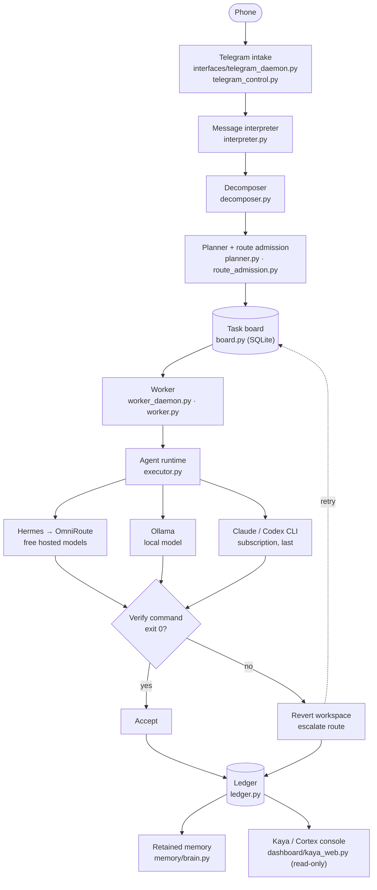
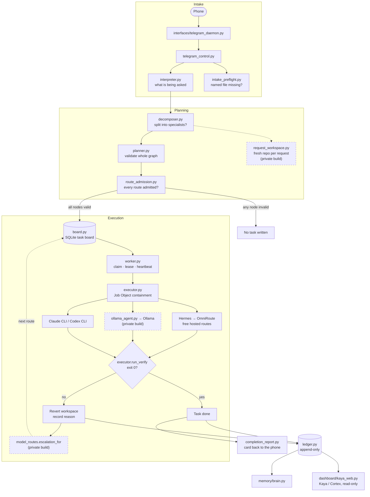
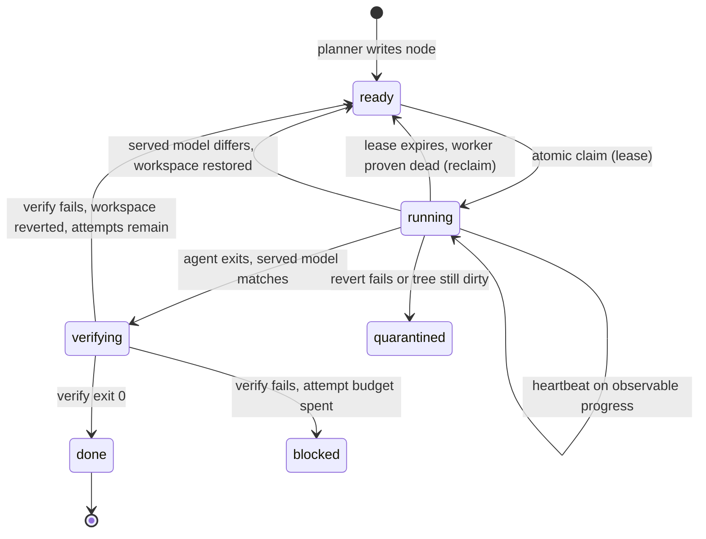
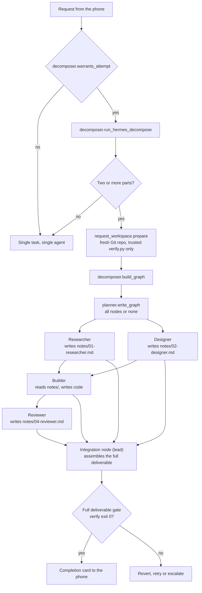

# Architecture

Tri-AI turns a request into verified work. Its parts are deliberately ordinary — a SQLite task
board, a worker loop, a router, a verifier — and the design effort goes into one property: an
agent's own report never decides whether its work is accepted.

Module names below are files in `src/`. Parts marked *private build* exist in the creator's
private deployment and are described here so the diagrams are complete; they are not in this
repository (see the [README](../README.md#this-repo-vs-the-private-build)).

## Bird's-eye view

One box per module in `src/`. This is the graph the README used to carry; the README now explains
the same flow with an illustrated five-step strip, and this page keeps the exact modules.

## Codemap

Where the thing that does X lives.

| path | what |
|---|---|
| `src/board.py` | task board on the Hermes kanban kernel, plus `verify_command` |
| `src/worker.py`, `src/worker_daemon.py` | claim → agent → verify → accept or revert |
| `src/executor.py` | agent runtimes, process containment, verifier execution |
| `src/route_admission.py`, `src/routing_probe.py`, `src/model_routes.py` | route registry and admission |
| `src/decomposer.py`, `src/planner.py` | request → validated task graph |
| `src/telegram_control.py`, `src/interfaces/telegram_daemon.py`, `src/interpreter.py` | phone intake |
| `src/daemon_supervisor.py` | keeps the worker and Telegram daemons running |
| `src/ledger.py`, `src/memory/` | append-only evidence and retained memory |
| `src/dashboard/` | Kaya console and Cortex view (read-only) |
| `public-demo/` | the sealed demo server and its synthetic snapshot |
| `evidence/` | the published ledger and model sweep |
| `config/` | example registries; real ones live outside the clone |
| `docs/` | architecture, routing, setup, operations |

Invariants worth knowing, stated as absences: the console never imports the board's write path;
no task is accepted on an agent's report; no route is used before it is admitted; a revert never
deletes (it stashes).

## Where things run

| machine | role |
|---|---|
| Desktop (always on, 12 GB GPU) | runs the supervisor, the worker, the Telegram daemon, Ollama, the router and the console |
| Laptop | development and review; a client of the desktop, not a dependency of it |
| Phone | sends requests and receives completion cards over Telegram |

`src/daemon_supervisor.py` keeps the worker (`worker_daemon.py`) and the Telegram daemon
(`interfaces/telegram_daemon.py`) running and records their state. Long jobs are registered as
scheduled tasks rather than launched over a remote shell, because a process started over SSH dies
with the session ([AUTONOMY.md](AUTONOMY.md)).

## System flow

### Intake

`telegram_control.py` turns a plain message into either a task or a question back. The
interpreter (`interpreter.py`) restates the request and decides whether it is clear enough to
start; a reply to a completion card is read as a refinement of that task rather than a new one.
`intake_preflight.py` warns, before the task is confirmed, when a request names a file that is not
in the target workspace — the usual sign of a mis-aimed run.

### Planning

`decomposer.py` decides whether a request warrants splitting and, if so, asks Hermes for a
decomposition and builds a graph of specialist nodes. `planner.py` validates the graph whole —
dependency cycles, nodes without a verify command, unadmitted routes — and writes every node or
none.
`route_admission.py` is the check that a node's `model_route` resolves to an admitted route in
the operator's registry; graph input never carries raw model or provider strings.

### Execution

`worker.py` is the loop that matters. For one claimed task:

1. **Precheck** the workspace: clean tree, expected branch for task-owned worktrees.
2. **Run the agent** through `executor.py`, inside a Windows Job Object so the whole process
   tree is killed on timeout. A prompt too long for the command line is refused before spawn.
3. **Check the served model.** If the usage record shows a different model from the one
   requested, the run is an environment failure: the workspace is restored and the verifier is
   not run over work the requested model did not do.
4. **Check declared artifacts.** A task that names a file it must produce cannot pass on a
   text-only claim.
5. **Run the verifier** (`executor.run_verify`). Only exit 0 completes the task.
6. **Otherwise revert**: `executor.revert` stashes (never deletes), then `git status --porcelain`
   must come back clean. If it does not, the workspace is quarantined and the worker stops.

A retry is given the previous attempt's verifier reasons, read from its `verify.log`, so it does
not repeat the same mistake blind.

### Evidence and console

`ledger.py` appends one line per attempt: agent exit, verify exit, duration, requested and served
model, runtime, output tail and, in the private build, which escalation step ran it.
`memory/brain.py` keeps retained context with provenance and trust labels
([BRAIN_ARCHITECTURE.md](BRAIN_ARCHITECTURE.md)). `dashboard/kaya_web.py` serves Kaya, the
console, and its Cortex view. It opens the board read-only (`mode=ro`, `PRAGMA query_only=ON`);
AST tests fail if a dashboard module imports the board.

## Task lifecycle

Three properties make this hold under real conditions:

- **The claim is atomic.** `tests/test_claim_contention.py` races two real processes for one
  task; exactly one wins.
- **The heartbeat is earned, not timed.** A heartbeat on a timer would vouch for a run hung on a
  dead socket. The lease is renewed only when the agent produced output or changed a file since
  the last beat. Hermes one-shot writes its stdout once, at exit, so file changes are the signal
  that actually moves during a run. Silence stops the beat and the kernel stops renewing.
- **Reclaim checks liveness correctly.** On Windows, `os.kill(pid, 0)` reports live processes as
  dead and a bare `OpenProcess` handle reports dead ones as live. `process_liveness.py` uses
  `GetExitCodeProcess` and requires `STILL_ACTIVE`. A dead worker's task returns to `ready`; a
  live worker's claim is left alone (`tests/test_reclaim.py`).

## Routing and escalation

A route is a named entry in an operator-owned registry: runtime, model, provider, and whether it
is admitted. Admission requires an agentic probe — Hermes (or the route's runtime) in a disposable
repository, a marker file written, a verifier passed — and a usage record whose served model is
exactly the requested one. A route whose name sounds right proves nothing: in the published sweep
every `auto/*` alias served a different model at HTTP 200 ([MODEL_SWEEP.md](../evidence/MODEL_SWEEP.md)).

In the private build, a failed task moves one step down an ordered chain, free routes first. The
builder chain as of 2026-10-05, ordered by a one-build-per-route benchmark (build passers fastest
first, then routes that had only passed the marker probe):

```mermaid
flowchart LR
    own["Task's own route<br/>e.g. Mistral Codestral"] -- fail --> l1["Local Ollama<br/>Ornith 9B"]
    l1 -- fail --> f1["NVIDIA<br/>Nemotron 3 Super 120B"]
    f1 -- fail --> f2["NVIDIA<br/>Kimi K3"]
    f2 -- fail --> f3["NVIDIA<br/>Laguna XS 2.1"]
    f3 -- fail --> f4["OpenRouter free<br/>Qwen 3.8 27B"]
    f4 -- fail --> f5["Mistral<br/>Mistral Code"]
    f5 -- fail --> f6["Google AI Studio<br/>Gemini 3.5 Flash Lite"]
    f6 -- fail --> s1["Antigravity (AI Pro)<br/>Gemini Pro agent"]
    s1 -- fail --> s2["Antigravity (AI Pro)<br/>Gemini 3.7 Flash"]
    s2 -- fail --> s3["Claude CLI<br/>subscription"]
    s3 -- fail --> blocked[Blocked for review]
    subgraph free["Free: local and hosted free tiers"]
        l1
        f1
        f2
        f3
        f4
        f5
        f6
    end
    subgraph flat["Flat-rate subscriptions"]
        s1
        s2
        s3
    end
```

Rules the chain obeys (`model_routes.escalation_for`, `worker.py`):

- Every step must be an admitted route; a broken policy is logged and the task stays on its own
  route rather than failing.
- A subscription runtime never receives a Hermes model pin.
- The attempt budget is the chain's length plus the task's own attempt, so the circuit breaker
  does not block a task before the chain is exhausted.
- Each ledger line records `escalated_to`. Turning escalation off keeps every task free.

[ROUTING.md](ROUTING.md) covers the measurements behind the order.

## Fan-out: one request, many specialists

The roles above are an example; the decomposer chooses them per request. What the graph
guarantees in the private build:

- **Every node sees the whole request**, labelled as context, and is told to read `notes/` and
  the existing workspace first. A part the decomposer forgot to assign is still visible to
  someone.
- **Non-build nodes must leave a file.** Research, design, review and docs nodes declare
  `notes/NN-role.md` as an expected artifact, so the worker's declared-artifact check fails a
  node that only answered in prose — before its dependants start.
- **Specialists share one repository per request**, created by `request_workspace.py` and
  seeded with nothing but the trusted verifier, so each node builds on the last one's files and
  no request can see another's.
- **Only the integration node carries the full deliverable gate.** Specialists run with
  `taste_scope: "skip"`; the final node, which depends on every specialist, runs with
  `taste_scope: "final"`. A fan-out cannot escape the gate a single agent is held to, and a
  research node is not failed for having no web page.

In this repository the decomposer, graph validation and Telegram fan-out exist; the shared
per-request repository, the `notes/` handoff and the integration node are private-build only.

## Hermes facts that cost real time

[Hermes Agent](https://hermes-agent.nousresearch.com) is the default agent runtime, called as a
one-shot (`hermes -z "<prompt>"`). Two of its behaviours shape the prompts Tri-AI writes:

1. **`cd` does not persist between commands** in its terminal tool; every shell starts in the home
   directory. Each command must carry its own `cd <repo> &&`, or the agent reports "not a git
   repository" and the task looks broken when it is only lost. `executor.py` adds this instruction to
   every Hermes prompt.
2. **Hermes needs a model with at least 64,000 tokens of context.** That silently disqualifies
   `qwen3:14b` (40,960) and `qwen2.5-coder:14b` (32,768) — including as Hermes' auxiliary
   compression model, which aborted one benchmark build. Check `ollama show <model>` first.

## Why not a general agent framework

The failure this system is built around is not too little orchestration. It is a plausible wrong
answer accepted as correct. A more elaborate graph of agents does not fix that; an exit code does.
The fan-out graph exists to divide work, and every node in it — including the last — still has to
pass a command that does not care what the agent says about itself.
