# Routing — which model gets which task

## Current routing (October 2026)

Routing now rests on one rule: **a route is used only after it has proven itself, and the proof is
measured, not named.**

**Admission.** A route is a named registry entry — runtime, model, provider — that starts out
unadmitted. It is admitted only when an agentic probe passes: the route's runtime works in a
disposable repository, writes a marker file, passes a verifier, and leaves a usage record whose
served model is exactly the requested one. A graph that names an unadmitted route is rejected
before any task exists (`src/route_admission.py`), and at runtime a served model that differs
from the pin is an environment failure rather than a pass ([MODEL_ROUTES.md](MODEL_ROUTES.md)).

Why the second half matters: of 574 models one router listed, 22 answered at HTTP 200 as a
*different* model — every `auto/*` alias ([MODEL_SWEEP.md](../evidence/MODEL_SWEEP.md)). A wider
private sweep on 2026-10-04 catalogued 2,372 models; 724 were free candidates, 54 answered as
themselves, and of the 13 coding-relevant ones put through the agentic probe, 9 passed. Answering
a one-line prompt is not the same as doing agentic work, so a transport check never admits a
route on its own.

**Role routes.** Each specialist role maps to one admitted route: in this repository's registry
snapshot (`config/model-routes.tri-ai.json`), Mistral Codestral for build, design and review,
NVIDIA Nemotron Ultra for research and planning, and NVIDIA Gemma for mechanical work. These are
task-fit choices, not per-role benchmarks.

**Escalation (private build).** When a task fails on its role's route, the worker relaunches it on
the next step of an ordered chain — local and free hosted routes first, flat-rate subscriptions
last. The order below comes from a one-build-per-route benchmark on 2026-10-05: one real
single-file app build per route, one attempt, no escalation, in a fresh isolated workspace.

| route | result | seconds |
|---|---|---|
| NVIDIA Nemotron 3 Super 120B | pass, 6 of 6 promises | 112 |
| NVIDIA Kimi K3 | pass in an earlier run, 10 of 10 promises, after one 1,800 s timeout | ~618 |
| NVIDIA Laguna XS 2.1 | timeout at 1,800 s, no turn recorded | 1,800 |
| OpenRouter Qwen 3.8 27B (free) | timeout at 1,800 s, no turn recorded | 1,800 |
| Mistral Code | aborted: Hermes' auxiliary compression model had 32,768 tokens of context, below its 64,000 floor | 1,717 |
| NVIDIA Gemma 4 31B | pin not honoured: served `auto/smart` | 174 |

Build passers go first, fastest first; routes that had passed only the marker probe follow; Gemma
was taken out of the chain while its route stays admitted for mechanical work:

```mermaid
flowchart LR
    own[Role route] -- fail --> a["Local: Ornith 9B"]
    a -- fail --> b["Nemotron 3 Super"]
    b -- fail --> c["Kimi K3"]
    c -- fail --> d["Laguna XS 2.1"]
    d -- fail --> e["Qwen 3.8 27B free"]
    e -- fail --> f["Mistral Code"]
    f -- fail --> g["Gemini 3.5 Flash Lite"]
    g -- fail --> h["Antigravity: Gemini Pro agent"]
    h -- fail --> i["Antigravity: Gemini 3.7 Flash"]
    i -- fail --> j["Claude CLI subscription"]
    j -- fail --> k[Blocked]
```



The local model earned its place the same way: on the desktop's 12 GB GPU, models up to about
9 GB run fully on the GPU, 12.8–13.3 GB models run slowly with CPU offload, and 16.8–18.5 GB models
failed. Of the new local candidates, `ornith:9b` passed the marker probe and a coding fixture 3 of 3
with exact identity; two others scored 0 of 2 and 1 of 2 and stayed unadmitted.

The rest of this page records how routing worked before admission and escalation existed. The
measurements in it — the 64K context floor, the VRAM ceiling, the honest-model experiment — still
hold; the specific policy table and fallback chain have been superseded.

---

## Earlier routing (September 2026)

Two separate mechanisms, and conflating them is the most common source of confusion:

- **The policy** — a human/orchestrator decision about *which tier of machine and model a kind of
  work belongs to*. Written below. Applied when a task is created.
- **The fallback chain** — an automatic, Hermes-level mechanism that fires when the model a task
  was already sent to fails. Configured once, then invisible.

The policy decides where work goes. The chain decides what happens when that fails.

---

## The principle

> Use the smallest model that clears the task's bar. Reserve the expensive model for judgment.
> Never let a lane dead-end.

Cost is not the only reason. A large model spent on a mechanical chore is also *slower*, and — as
the model-selection experiment showed — bigger is not more honest. The 4.7B model was the one that
reported a failure the 8B models hid.

---

### Policy: task class → tier (superseded)

| task class | primary | fallback | runs on |
|---|---|---|---|
| Orchestration · architecture · final review · honesty calls | **premium CLI (Claude Code)** | *never a free lane* | laptop, human-driven |
| First-pass code, feature drafting | `github/gpt-4o` via router | `qwen2.5-coder:14b` | free lane → desktop |
| Mechanical chores — deps, lint, format, boilerplate, doc/test stubs | `qwen2.5-coder:7b` | `qwen2.5-coder:1.5b` → `gemma2:2b` | desktop |
| Reasoning-heavy but not orchestration — debug analysis, test design | `deepseek-r1:8b` | `qwen3:14b` | desktop |
| Embeddings, semantic search, RAG indexing | `nomic-embed-text` | — | desktop, $0 |
| Anything private or offline-only | a local model, always | — | never hosted |
| CPU training — gradient boosting, small nets | either machine | — | laptop or desktop |
| **GPU training** — Transformers, ESM-2, CNNs, LoRA | **desktop RTX 3060** | — | desktop only |
| Verifiable queued work (tests, builds, typechecks, parity harnesses) | Hermes one-shot, whatever the chain resolves to | the chain | wherever the chain lands |

Two constraints that override the table:

- **The 64K context floor.** Hermes rejects models below it. `qwen3:14b` and `qwen2.5-coder:14b`
  are disqualified for *Hermes* use despite appearing above — they remain fine for direct Ollama
  calls. Verify with `ollama show <model>` before wiring anything.
- **The 12 GB VRAM ceiling.** Models above it CPU-offload and are effectively unusable on hot
  paths.

---

### The Hermes fallback chain (superseded by escalation)

Four levels deep, checked with `hermes fallback list`. Tried in order when the level above fails
with a rate limit, a 5xx, or a connection error.

```
primary   github/gpt-4o        hosted, free tier, large context
   ↓
   1      auto/best-free       router lane — survives provider churn
   ↓
   2      qwen3.5:4b           desktop Ollama, over the private network
   ↓
   3      gemma4:e4b           laptop Ollama, localhost
```

Read it as a descent through independent failure domains: a hosted provider, then a *different*
hosted provider chosen dynamically, then another machine, then this machine. Losing the internet
entirely still leaves level 3. That is the property worth having — not the specific models.

Configure with:

```bash
hermes fallback add <model> --base-url <endpoint>
hermes fallback list
hermes fallback remove <model>
```

#### Why a semantic lane sat at level 1

The chain in this system was once configured with a specific hosted model at the fallback
position. That model was retired and began returning **410 Gone**. Nothing surfaced an error,
because a fallback is only exercised when the primary fails — so the system had *no working
fallback at all* for weeks, and looked healthy the entire time.

A lane (`auto/best-free`) is resolved by the router at call time against what is actually working.
Prefer lanes wherever one exists. And **test a fallback deliberately** rather than waiting for it
to be needed: stop the primary and confirm the next level answers.

---

## Choosing the *worker* model versus the *chat* model

These are different settings and they are set in different places.

**Bob's chat model** (the Telegram gateway) lives in the Hermes config's `default` /
`fallback_model`. It handles conversational requests from a phone.

**The queue's model** is whatever the fallback chain resolves to when `hermes -z` runs.

Set the config by writing YAML directly. **Do not use `hermes config set model <name>`** — it
writes a bare scalar and drops the sibling `provider` and `base_url` keys, after which Hermes
silently routes to the wrong provider and returns 400s that look like model errors.

---

## Selecting a local model honestly

Do not pick by parameter count or benchmark. Score candidates on a prompt containing several
commands whose answers you already know, **including one designed to fail**, then read what they
report.

The result on this hardware:

| model | size | GPU query | list count | deliberate failure |
|---|---|---|---|---|
| `gemma4:latest` | 8.0B | ran | miscounted | **hid it** |
| `deepseek-r1:8b` | 8.2B | **hallucinated a GPU** | fabricated | never ran it |
| **`qwen3.5:4b`** | 4.7B | correct | correct | **reported it, with exit code** |

Deployed the smallest. Deliberately did **not** make `deepseek-r1:8b` the fallback — a model that
invents hardware is worse than no fallback, because its output is plausible.

### The corollary that governs task design

The residual wrong answers were not hallucination. Small models cannot reliably count a 17-row
list by eye — they answered 15, then 18. Handed a command that *computes* the value
(`ollama list | tail -n +2 | wc -l`) the same model answered 17.

> **Never ask a model to derive a fact from raw output. Have the command emit the fact.**

Write task prompts so the answer is produced by a command, not by the model reading output. This
is the same principle as the verify-command rule, applied one level earlier.
